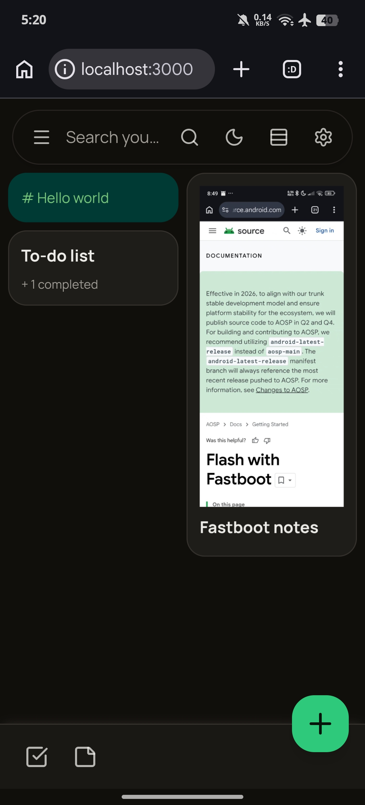
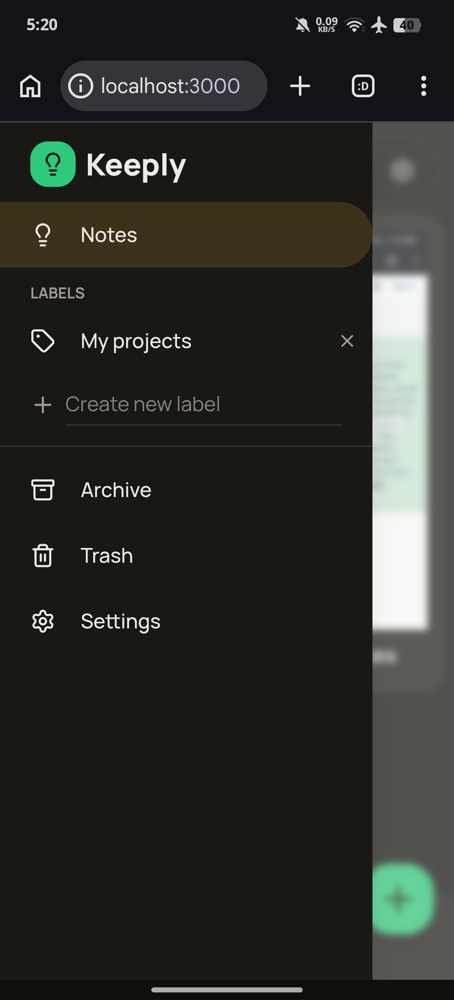
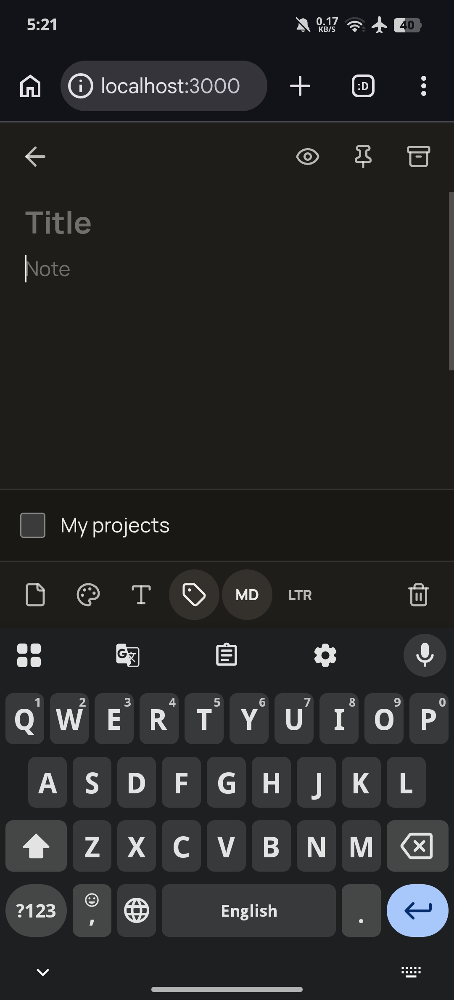

# Keeply

A fast, lightweight, and modern local notes & checklists app. Capture ideas, organize tasks, and keep everything in one place with a smooth experience.

  
  
  

  
  
  

## Features

- **Notes & Checklists**: Create plain text notes or interactive to-do lists with checkable items.
- **Rich Text Styling**: Customize font size, bold, italic, underline, strikethrough, and text color.
- **Markdown Preview**: Write notes in Markdown and preview them instantly with support for headings, lists, links, code blocks, blockquotes, and more.
- **Media Attachments**: Attach images and videos with automatic thumbnail generation (stored locally in IndexedDB).
- **Drag & Drop Reordering**: Intuitive drag-and-drop to reorder notes in grid or list view.
- **Long-Press Selection**: Multi-select notes with long-press for batch actions (pin, archive, trash, delete).
- **Labels & Organization**: Create custom labels to organize notes and filter by label.
- **Pin, Archive, Trash**: Pin important notes, archive old ones, and restore or permanently delete from trash.
- **Search**: Quickly find notes by title, content, checklist items, or labels.
- **Color Themes for Notes**: Personalize notes with a variety of background colors.
- **Theme Customization**: Light/dark mode with multiple accent theme colors (Amber, Emerald, Blue, Purple, Rose, Orange).
- **Font Options**: Choose between Manrope, Lora (serif), and Space Mono.
- **RTL & LTR Support**: Switch text direction per note for multilingual content.
- **Responsive Design**: Adapts smoothly to different screen sizes with fluid layouts.
- **Local-First**: All data is stored locally in your browser (localStorage + IndexedDB). No account or cloud sync required.
- **Smooth Animations**: Subtle transitions, hover effects, and micro-interactions throughout the UI.

## License

This project is licensed under the **GNU General Public License v3.0** (GPLv3).

See the [LICENSE](LICENSE) file for full details.
